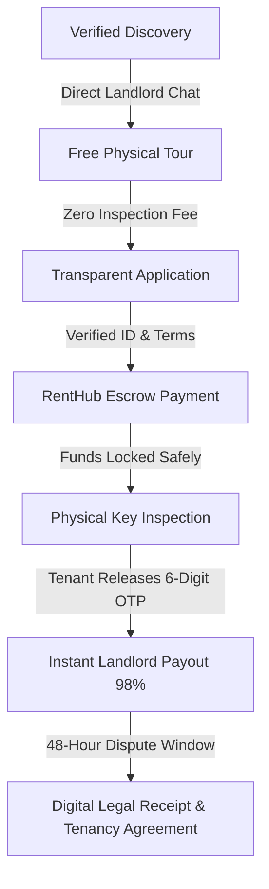

# 🚀 RentHub: The Zero-Agent Rental Revolution in Nigeria

> **"Renting a home in Nigeria shouldn't feel like surviving an organized scam."**  
> We are building the trust infrastructure that eliminates the **₦10+ Billion "Agent Tax"** across Nigeria's 36 states and the Federal Capital Territory.

---

## 💥 The Nigerian Housing Crisis: The "Agent Tax"

Every year, millions of working Nigerians—bankers in Victoria Island, tech professionals in Yaba, civil servants in Abuja, entrepreneurs in Port Harcourt, and students in Enugu—fall victim to an outdated, unregulated, and predatory rental cartel.

### The Everyday Nigerian Renting Nightmare:
* **The Tollgate Inspection Fee**: Paying ₦5,000 to ₦15,000 just to view a house with peeling paint, no running water, and leaking ceilings.
* **The 10% – 20% "Agent Fee" Extortion**: An agent who spent 15 minutes opening a gate demands ₦300,000 on a ₦1.5M/year apartment—for doing virtually nothing.
* **The "Agreement & Commission" Inflation**: Arbitrary 10% legal fees drafted on photocopied 1-page templates with zero legal standing under the Lagos Tenancy Law 2011 or Abuja Recovery of Premises Act.
* **The Multiple-Tenant Scam**: Paying rent to a rogue agent who collected money from 5 different people for the exact same apartment and switched off their phone.
* **The Hostage Caution Deposit**: Caution deposits that are pocketed by landlords and never returned, regardless of how spotless the apartment is kept.

### The Mathematics of Exploitation
| Line Item | Traditional Market | RentHub | Your Savings on a ₦2,000,000 Apartment |
| :--- | :--- | :--- | :--- |
| **Annual Rent** | ₦2,000,000 | ₦2,000,000 | Same Fair Value |
| **Inspection / Showing Fee** | ₦10,000 – ₦25,000 (accumulated) | **₦0 (Free)** | **+₦25,000 saved** |
| **Agent Commission (10-20%)** | ₦200,000 – ₦400,000 | **₦0 (0% Agent Fee)** | **+₦400,000 saved** |
| **Legal / Agreement Fee** | ₦200,000 (arbitrary) | **Compliant Model Template** | **+₦150,000 saved** |
| **Escrow Security & Guarantee** | ❌ None (Cash / Direct Transfer) | **✅ 100% Escrow Protected** | **Priceless Peace of Mind** |
| **Key Handover Safety** | ❌ Trust in luck | **✅ 6-Digit Handover OTP** | **Zero Fraud Risk** |
| **Total Upfront Cash Required** | **₦2,500,000+** | **₦2,040,000** | **Save up to ₦460,000+ upfront!** |

---

## 🛡️ The RentHub Solution: 100% Escrow & 0% Agent Fee

RentHub connects verified landlords directly with verified tenants. No gatekeepers. No middleman markup. No fake keys.

### The 5 Iron-Clad Pillars of RentHub

#### 1. 0% Agent Commission
Tenants never pay agent fees. Ever. A tenant renting an apartment for ₦1,500,000 pays for the apartment and a tiny 2% platform escrow protection fee. The ₦150,000–₦300,000 agent fee stays in their pocket where it belongs.

#### 2. The 100% Escrow Guarantee
When a tenant pays their rent on RentHub via Paystack, **the money does NOT go to the landlord immediately**. The funds are secured in an audited, bank-grade escrow account. The landlord cannot touch the money until the tenant physically walks through the door.

#### 3. The 6-Digit Key Handover OTP Protocol
Never hand over keys without the OTP. Never release money without the keys:
1. When rent is paid into escrow, the tenant generates a secret **6-Digit Handover OTP**.
2. Both parties meet physically at the property for final walkthrough inspection.
3. The tenant verifies the running water, power meters, windows, and physical locks.
4. If satisfied, the tenant hands over the 6-digit OTP to the landlord in exchange for physical keys.
5. The landlord enters the OTP on their RentHub dashboard, triggering an instant 98% bank payout.

#### 4. Physical Property & Title Verification
Every "Verified" property on RentHub undergoes a rigorous audit:
* Physical GPS coordinate validation to eliminate ghost apartments.
* Verification of light meters (prepaid vs postpaid), borehole/water supply, and inverter/generator backup.
* Landlord identity and ownership verification via government-approved databases (NIN, CAC, Title Deeds).

#### 5. Legal Contract Toolkit & Tenancy Law Compliance
RentHub provides standardized, legally enforceable tenancy agreements adhering strictly to the **Lagos State Tenancy Law 2011** and the **Recovery of Premises Act (Abuja & Northern States)**. Every completed transaction generates an instant, tamper-proof Digital Rent Receipt and Tenancy Agreement.

---

## 📈 The Market Opportunity

Nigeria is Africa's largest economy with a population surpassing 220 million people and an urban growth rate exceeding 4.3% per annum:

* **$30+ Billion Annual Rental Turnover**: Over 18 million households rent in Nigerian urban centers.
* **45% Urbanization Pressure**: Lagos alone absorbs over 2,000 new residents daily; Abuja, Port Harcourt, Ibadan, and Enugu are experiencing massive housing demand surges.
* **Massive Pain Point**: 94% of Nigerian urban renters surveyed rank agent fees and rental fraud among their top 3 financial anxieties.
* **The Target**: **Save Nigerian renters ₦10 Billion in unearned agent commissions over the next 5 years.**

---

## 💎 Why RentHub Wins: The Value Proposition

### For Tenants: Total Liberation
* **Keep Your Money**: Save up to 20% on every single move.
* **Zero Scam Anxiety**: No rogue agents, no duplicate leases, no fake property pictures.
* **Free Showing Calendar**: Schedule property viewings directly with landlords at times that suit you.
* **Automated Tenancy History**: Build an authenticated rental track record that makes renting future apartments effortless.

### For Landlords: Better Yields, Zero Stress
* **100% Free Property Listings**: Reach thousands of high-earning, verified tenants directly across Nigeria and the Diaspora.
* **Guaranteed Solvency**: You know the rent is already sitting safely in escrow before you hand over physical keys.
* **Fast Vacancy Fill**: Properties listed on RentHub receive 3.8x faster tour requests than properties hidden behind multiple layers of street agents.
* **Direct Tenant Vetting**: Screen employment, identity, and past rental conduct with full compliance.

---

## 🏛️ Comprehensive Coverage: All 36 States + FCT

RentHub is engineered for national scale:

* **Lagos State**: Victoria Island, Ikoyi, Lekki Phase 1, Ikeja GRA, Surulere, Yaba, Magodo, Ajah.
* **Federal Capital Territory (Abuja)**: Maitama, Asokoro, Wuse 2, Garki, Guzape, Jabi, Gwarinpa, Lugbe.
* **Rivers State**: Old GRA, New GRA, Peter Odili Road, Trans-Amadi, Ada George, Port Harcourt.
* **Oyo State**: Bodija, Jericho, Oluyole, Agodi GRA, Ring Road, Ibadan.
* **Enugu State**: Independence Layout, New Haven, Trans-Ekulu, GRA, Enugu.
* **Anambra, Delta, Edo, Kano, Kaduna, Ogun, Akwa Ibom, Imo, and beyond**.

---

## ⚡ The RentHub Tech Stack

A battle-tested, high-performance architecture built for 99.99% uptime and zero latency:

* **Frontend**: Next.js 16 (Turbopack, App Router), TypeScript, Tailwind CSS, Lucide React, Framer Motion.
* **Backend**: Node.js, Express.js (Modular Controllers & Services), TypeScript.
* **Database & ORM**: PostgreSQL with Prisma ORM (41 indexed schemas, soft deletes, spatial coordinates).
* **Identity & Security**: Clerk Authentication (Biometric, Passkey, OAuth, Multi-Factor Authentication).
* **Payment Engine**: Paystack Multi-Tier Escrow Subaccounts & Instant Automated Settlement.
* **SMS & Communications**: Termii Verified Sender ID OTP Routing.
* **Cloud Storage**: Cloudinary High-Def Image & Video Media Pipelines.

---

## 🤝 Join the Movement

We are on a relentless mission to restore dignity, fairness, and trust to the Nigerian rental housing sector.

* **Looking for a Home?** 👉 [Explore Verified Listings on RentHub](https://renthub-seven.vercel.app/search)
* **Are You a Property Owner?** 👉 [List Your Property for Free](https://renthub-seven.vercel.app/properties/new)
* **Read Our Legal Guides & Manifesto**: 👉 [RentHub Resources Portal](https://renthub-seven.vercel.app/resources)
* **Partnerships & Inquiries**: `partnerships@renthub.ng`

---

*RentHub Nigeria — Rent Directly. Pay Safely. Keep Your Money.*
