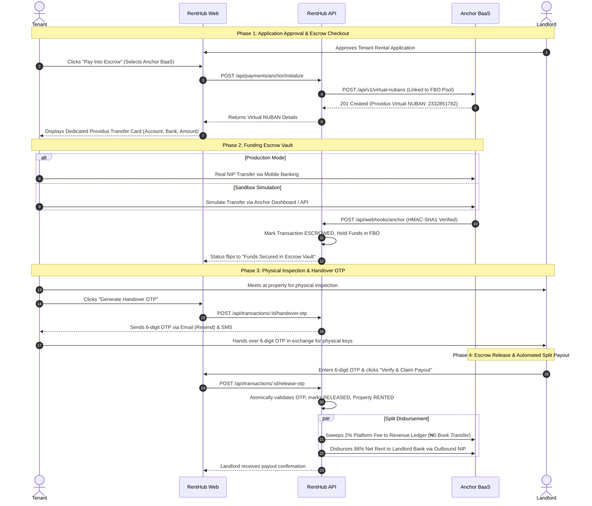
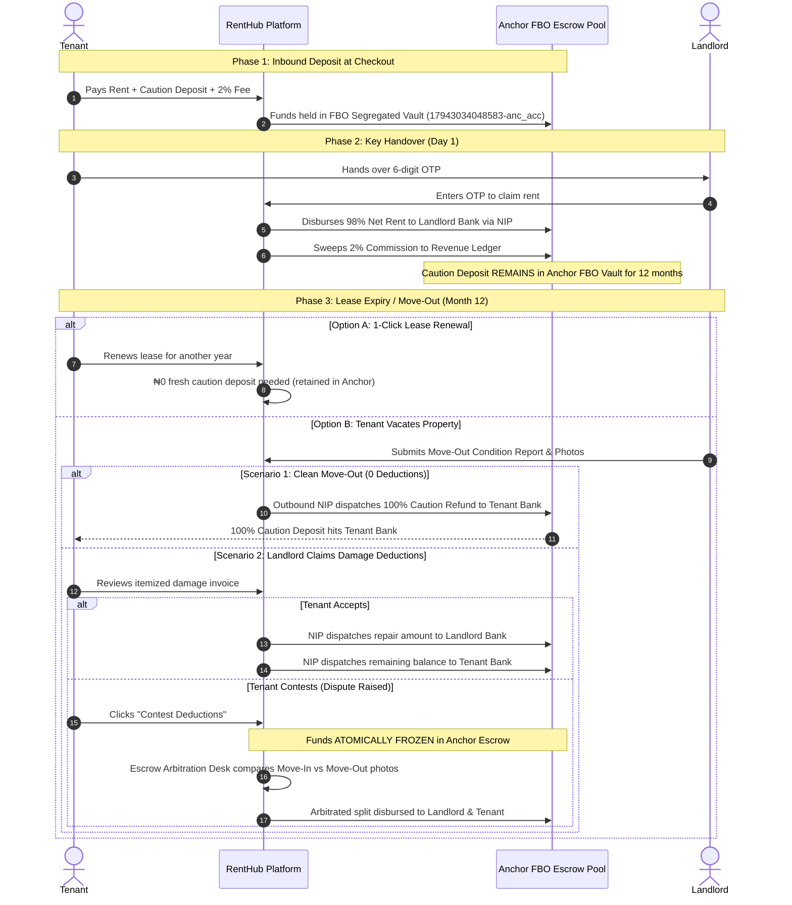

# Anchor BaaS Escrow: End-to-End Testing & Lifecycle Guide

**Platform:** RentHub (NexGen Tech Innovations Ltd)  
**Provider:** Anchor Software Ltd (BaaS Partner — Providus Bank Rail)  
**Environment:** Sandbox (`https://api.sandbox.getanchor.co/api/v1`)  
**Scope:** Complete lifecycle from Tenant Application Approval → Dedicated Virtual NUBAN Generation → Deposit Simulation → Webhook Reconciliation → 6-Digit Handover OTP → Landlord Payout & Revenue Sweep.

---

## Architecture Overview

---

## Account Topology & Roles

| Account ID | Anchor Type | RentHub System Role | Fee / Cost |
| :--- | :--- | :--- | :--- |
| **`17943034048583-anc_acc`** | `FBO` | **Escrow Holding Vault (`ANCHOR_ESCROW_POOL_ID`)**: Segregated trust account. Holds rent and caution deposits until key handover. | Free |
| **`17943034048272-anc_acc`** | `REVENUE` | **Platform Earnings (`ANCHOR_REVENUE_LEDGER_ID`)**: RentHub's 2% commission fee is swept here upon OTP validation. | ₦0 Internal Sweep |
| **`17943034047460-anc_acc`** | `SETTLEMENT` | **NIP Clearing Account**: Anchor's automated clearing rail for outbound bank disbursements to landlords. | ₦50 / Payout |
| **`17943034048081-anc_acc`** | `MASTER` | **Corporate Treasury**: Parent organization account. | Free |

---

## Step-by-Step Testing & Follow-Up Walkthrough

### Step 1: Initiate Payment from RentHub Platform

1. Log into RentHub as a **Tenant** (`https://renthub-seven.vercel.app` or local `localhost:3000`).
2. Navigate to **Dashboard → Applications** tab.
3. Find an **APPROVED** application and click **"Pay Into Escrow"**.
4. In the modal, select:
   * **Bank Transfer (Dedicated Escrow — Anchor BaaS)** *(Recommended · 0% Fee)*
5. Click **"Proceed with Anchor BaaS"**.

#### What Happens Under the Hood:
* RentHub API calls Anchor API: `POST /api/v1/virtual-nubans`.
* Anchor provisions an instant Providus Bank virtual account (e.g. `2332851782`) tied directly to your FBO pool.
* RentHub displays the persistent **Dedicated Providus Escrow Account Card**:
  * **Bank:** `PROVIDUS BANK`
  * **Account Number:** `2332851782` (with 1-click copy)
  * **Account Name:** `RentHub: [Tenant Name]`
  * **Exact Amount:** `₦[Total Rent + Caution + 2% Fee]` (with 1-click copy)
  * **Status Banner:** *"Awaiting Inbound Transfer — Reconciles automatically upon receipt"*.

---

### Step 2: Fund the Escrow in Anchor Sandbox

Since we are in the Sandbox, you simulate the tenant making the bank transfer:

1. Open your **Anchor Dashboard**: `https://app.getanchor.co`.
2. Go to **Accounts → Deposit Accounts**.
3. Click the **Simulate Transfer** button.
4. Fill out the simulation modal:
   * **Sandbox API Key:** Your test key (starts with `UYY2w...`).
   * **Account Number ID \*:** Enter the **Virtual NUBAN Resource ID** (e.g. `179443403814110-anc_acc_num`).  
     *(Do NOT use the parent `-anc_acc` ID; always use the `-anc_acc_num` Virtual NUBAN ID).*
   * **Source Account Number \*:** `0123456789` *(mock sender bank account)*.
   * **Source Account Name \*:** Any test name (e.g. `Harun Bah`).
   * **Amount \*:** The rent amount in Naira (e.g. `817786`).
5. Click **"Send Request"**.
6. The modal returns `200 OK` with a Payment ID (e.g. `1794434038...-anc_py`).

---

### Step 3: Webhook Verification & Automated Escrow Vaulting

1. Anchor dispatches an automated webhook event to:  
   **`https://renthub-4jhq.onrender.com/api/webhooks/anchor`**
2. RentHub backend validates the `Base64(HMAC-SHA1(rawBody, secretToken))` signature.
3. The transaction status transitions to **`ESCROWED`** (`escrowHeld = true`).
4. RentHub sends email confirmations to both Tenant and Landlord.
5. On the RentHub Dashboard, the card automatically updates to:  
   **"Funds Secured in Escrow Vault"** (Blue lock badge).

> [!NOTE]
> Ensure your Anchor webhook URL under **Developer → Webhooks** is configured as `https://renthub-4jhq.onrender.com/api/webhooks/anchor` (Render backend API), not the Vercel frontend URL.

---

### Step 4: Physical Inspection & 6-Digit Handover OTP

1. Tenant visits the property and physically verifies:
   * Physical keys, doors, and window locks.
   * Water supply, plumbing, and electrical fixtures.
   * House vacancy and match with listed photos.
2. Tenant opens RentHub Dashboard → **"Active Escrow & Key Handover"** tab.
3. Tenant clicks **"Generate Handover OTP"**.
4. RentHub generates a cryptographically secure 6-digit code:
   * Sent immediately to Tenant's registered email via Resend (`hello@nexgentech.dev`).
   * Rendered in high-contrast individual digit tiles for mobile and dark-mode visibility.
   * Delivered via SMS backup.
   * Notice: *"Never share this code over phone or WhatsApp. Give this code to the landlord ONLY after physically receiving the keys at the premises."*

---

### Step 5: Landlord Enters OTP & Automated Fund Release

1. Tenant hands the 6-digit code to the Landlord at the door in exchange for physical keys.
2. Landlord logs into RentHub Dashboard → **"Escrow & Payouts"** tab.
3. Under the property listing, Landlord enters the **6-Digit OTP** and clicks **"Verify & Claim Payout"**.
4. RentHub verifies the OTP:
   * **Brute-Force Guard:** Maximum 5 attempts allowed; atomic lock protection.
   * **Transaction Marked RELEASED:** `status = "RELEASED"`, `escrowReleased = true`.
   * **Property Updated to RENTED upon Payout Confirmation:** Property transitions to `status = "RENTED"` once Anchor confirms the outbound NIP transfer (`transfer.success` webhook). While the payout is in flight, the payout status shows `PROCESSING` to prevent false "settled" claims.
5. **Split Automated Disbursement**:
   * **2% Platform Fee (RentHub)**: Swept from FBO account (`17943034048583-anc_acc`) to Revenue account (`17943034048272-anc_acc`) via intra-bank Book Transfer (Free, ₦0 fee).
   * **98% Net Rent (Landlord)**: Disbursed directly from Anchor FBO to the Landlord's verified Nigerian commercial bank account via outbound NIP transfer (`ANCHOR_NIP`). (Note: The Caution Deposit remains safely held in the FBO caution sub-ledger for the duration of the tenancy and is NEVER disbursed to the landlord upfront).
   * **Payout Status:** `landlordPayout.status = "COMPLETED"`.
   * **Notification:** Landlord receives in-app and email alert confirming funds have hit their personal bank account.

---

### Step 6: Landlord Nigerian Bank Account Linking (Anchor BaaS Rail)

To receive automated NIP bank disbursements upon escrow release, landlords link their verified Nigerian commercial bank account:

1. Navigate to RentHub **Dashboard → Payouts & Settlements** tab (or **Profile → Payout Settlement**).
2. Select the **Commercial Bank (Anchor NIP)** rail tab (highlighted as **Recommended**).
3. Select your Nigerian bank from the dropdown (Access Bank, GTBank, Zenith, First Bank, Providus, UBA, etc.).
4. Enter your **10-Digit NUBAN Account Number**.
5. RentHub automatically resolves and verifies the account name against the Nigerian Inter-Bank Settlement System (NIBSS / Anchor BaaS).
6. Click **"Link Verified Bank Account"**.

#### 🧪 Sandbox Testing Hints & 1-Click Test Credentials
In the Anchor Sandbox environment, commercial bank verification and outbound NIP disbursements can be tested using Anchor's standard test bank credentials:
* **Bank:** `Access Bank` (CBN Code: `000014`)
* **Account Number:** `0123456789`
* **Account Name:** Auto-resolved to the Landlord's profile name
* **⚡ 1-Click Fast Fill:** Click the **"Fill Test Details ⚡"** button directly inside the green sandbox hint banner on the bank linking card to pre-fill these credentials instantly!

---

### Step 7: Escrow Settlement Records Table & Rail Differentiation

In the **Escrow Settlement Records** section of the Landlord Dashboard:

1. **Dual-Rail Filtering**:
   * **Rail Selector Pills:** Filter records by `[All Rails]`, `[Commercial Bank (NIP)]`, or `[AfriExchange Wallet]`.
   * **Status Pills:** Filter by `[All]`, `[Settled]`, `[In Escrow]`, `[Deferred]`, or `[Attention]`.
   * **Search Bar:** Real-time search by property title, tenant name, bank name, or reference ID.

2. **Visual Rail Badges in Records Table**:
   * **Anchor BaaS Rail:** Rendered with an emerald **`Commercial Bank (Anchor NIP)`** badge featuring a Landmark icon (`🏦`).
   * **AfriExchange Rail:** Rendered with a purple **`AfriExchange Wallet (NT)`** badge featuring a Wallet icon (`📱`).
   * **Net Payout Column:** Formatted clearly as Naira (`₦686,000`) for Anchor Bank NIP, and Naira Tokens (`₦686,000 NT`) for AfriExchange.
   * **Status Badges:** Shows **`Settled to Bank (NIP)`** for completed Anchor payouts and **`Settled to Wallet`** for AfriExchange payouts.

3. **Settlement Breakdown Modal**:
   Clicking **"Breakdown"** on any record displays:
   * **Payout Rail:** `Anchor BaaS Commercial Bank NIP` vs `AfriExchange Mobile Rail`.
   * **Recipient Bank:** Verified bank name (e.g. `Access Bank (Sandbox)`) and masked account number (`•••• 6789`).
   * **NIP Session ID:** Unique inter-bank settlement session ID for bank reconciliation.
   * **Idempotency Reference:** Cryptographic payout reference with 1-click copy button.
   * **Escrow Accounting:** Transparent itemization of Gross Rent Paid (100%), RentHub 2% Guarantee Fee, and Net Landlord Payout (98%).

---

### Step 8: Caution Deposit Custody, Move-Out Reclaim & Dispute Protocol

The Caution Deposit flow is a completely closed-loop, tri-party protocol between the **Tenant**, the **Landlord**, and **Anchor BaaS Escrow**.

#### 1. What Does "Caution Deposit" Actually Mean?
A **Caution Deposit** (also known as a **Security Deposit** or **Damages Deposit**) is a refundable holding buffer paid by the tenant before moving in to protect against physical property damage or unpaid utility bills left behind at the end of the tenancy.
* **It is NOT Rent:** It does not belong to the landlord and cannot be spent as income.
* **It is NOT a Platform Fee:** RentHub does not take a cut from the caution deposit.
* **It is 100% Refundable Collateral:** It must be returned to the tenant in full if the property is vacated in good condition with utility bills settled.

---

#### 2. Financial Accounting & 4% Total Take-Rate
RentHub operates on a **4% total platform revenue model**:
* **Tenant-Side (2% Escrow Protection Fee):** Paid on top of the rent at checkout.
  * *Example:* On a ₦1,000,000 annual lease, the tenant pays ₦20,000 protection fee.
* **Landlord-Side (2% Escrow Guarantee / Commission Fee):** Deducted from gross rent upon 6-digit key handover verification.
  * *Example:* On ₦1,000,000 rent, ₦20,000 is deducted, yielding a **₦980,000 net payout** (98%).
* **Platform Earnings:** RentHub collects ₦40,000 total (4%), which is swept into RentHub's Anchor Revenue Ledger (`17943034048272-anc_acc`) via a ₦0 intra-bank book transfer.

---

#### 3. Custodial Segregation: Who Holds the Caution Deposit?
**RentHub holds the Caution Deposit in the Anchor FBO Segregated Vault (`17943034048583-anc_acc`), NOT the Landlord.**

When the tenant hands over the 6-digit OTP and the landlord verifies it at the premises:
1. **Net Rent (98%)** is disbursed to the landlord's commercial bank account.
2. **Platform Commission (2% + 2%)** is swept to the RentHub revenue ledger.
3. **Caution Deposit REMAINS in Anchor FBO Escrow** for the entire 12-month tenancy.

This is codified in our statutory Tenancy Agreement covenants ([`transactionService.ts:656`](file:///Users/harz/Documents/backUps/izmir/renthub/apps/api/src/services/transactionService.ts#L656)):
> *"CAUTION DEPOSIT PROTECTION: Caution deposit remains held in RentHub segregated escrow throughout tenancy and is refundable upon move-out condition report sign-off."*

---

#### 4. Why Landlords Must Never Hold the Caution Deposit (RentHub's Defensive Moat)
In traditional Nigerian real estate, the caution deposit is fundamentally broken:
* Landlords treat it as free spending cash the day they receive it.
* When tenants move out 12 months later, landlords almost **never refund it** — fabricating bogus "repairs", citing normal wear and tear, claiming they don't have cash, or dodging calls. Over 80% of Nigerian tenants never get their deposit back.

##### RentHub's Defensive Moat Comparison:
| Traditional Nigerian Rental Market | RentHub Escrow Protocol |
| :--- | :--- |
| **Landlords hold caution deposits:** Spent immediately as personal cash. | **Anchor holds caution deposits:** Locked in institutional FBO segregated escrow (`17943034048583-anc_acc`). |
| **Tenants almost never get refunds:** 80%+ of Nigerian tenants never see their deposit returned. | **Guaranteed refund:** Impartial condition reports release funds back to tenant's bank via Anchor NIP. |
| **Zero renewal incentive:** Tenants must pay fresh caution deposits if they move or renew. | **1-Click ₦0 Caution Rollover (`renewalService.ts:95`):** Existing caution deposit rolls over on renewal with ₦0 out-of-pocket. |
| **Hostile disputes:** Disagreements end in shouting matches, police involvement, or litigation. | **Platform Arbitration Desk:** Impartial digital dispute resolution in under 48 hours. |
| **Zero financial float:** Funds vanish into private pockets. | **Fintech Custodial Float:** Thousands of active deposits create massive custodial escrow float in Anchor. |

---

#### 5. End-to-End Sequence Diagram

---

#### 6. Detailed Step-by-Step Move-Out Reclaim Trigger

At the end of the 12-month tenancy (or when the tenant gives statutory notice to vacate), the move-out protocol is triggered inside RentHub:

##### Step A: Digital Move-Out Condition Report (`submitMoveOutReport`)
* On or before the move-out date, the landlord (or tenant) opens the dashboard and completes the **Move-Out Condition Inspection**:
  * Uploads timestamped photographs of all rooms, fixtures, switches, walls, and plumbing.
  * Uploads cleared utility receipts (NEPA/PHCN electricity token meter bill, water board receipt, estate service levy).
  * If no damage occurred, landlord selects **"Property in pristine condition — ₦0 deductions"**.

##### Step B: Automated 100% Refund (When No Damages are Claimed)
* If the report shows ₦0 deductions, RentHub immediately transitions the caution status to `CLEARED_NO_DEDUCTIONS`.
* RentHub initiates an outbound NIP transfer from the **Anchor FBO Pool** directly back into the **Tenant’s verified Nigerian commercial bank account**.
* Tenant receives SMS and email alert confirming 100% refund of their caution deposit.

##### Step C: Landlord Itemizes Damage Deductions (If Repairs are Required)
* If there is actual tenant-inflicted damage (e.g. broken window pane, damaged kitchen cabinet):
  * The landlord submits itemized damage line items with repair estimates or contractor invoices:
    * *Item 1:* Repainting non-standard wall graffiti: ₦15,000
    * *Item 2:* Broken interior door handle: ₦10,000
    * *Total Claimed:* ₦25,000 (out of ₦100,000 Caution Deposit).
  * The report status moves to `PENDING_TENANT_REVIEW`.

---

#### 7. The Dispute Connection & Arbitration Protocol

What happens if the landlord makes an unfair or exaggerated claim?

##### 1. Tenant Instant Contest (`transactionService.ts:922`)
The tenant reviews the landlord’s claim on their dashboard and has two buttons:
* **"Accept Deductions"**: The ₦25,000 is sent to the landlord via Anchor NIP, and the remaining ₦75,000 is automatically refunded to the tenant's bank account.
* **"Contest Deductions" (Raise Dispute)**: If the tenant believes the charge is unfair (e.g. claiming ₦80,000 for normal sun fading on curtains or pre-existing cracks):
  * Tenant enters their reason and counter-evidence (e.g. photos taken on move-in day).
  * The transaction atomically transitions to:
    * `disputed: true`
    * `status: "CONTESTED_IN_ARBITRATION"`

##### 2. Atomic Escrow Freeze
* The moment a dispute is raised, **all funds are frozen inside Anchor FBO escrow**.
* Neither the landlord nor the tenant can withdraw or touch the caution deposit.
* The system enforces a 5-day resolution window governed by Nigerian Tenancy Law principles (fair wear-and-tear vs malicious damage).

##### 3. RentHub Escrow Arbitration Desk (`adminService.ts:525`)
RentHub administrators review the case using side-by-side evidence:
1. **Move-In Inventory Condition Report** (recorded in RentHub when keys were handed over 12 months earlier).
2. **Move-Out Report & Photos** submitted by the landlord.
3. **Statutory Tenancy Standards:** Normal wear-and-tear (minor paint scuffs, aging seals, weathered roofing) cannot legally be deducted from a tenant's deposit.

##### 4. The Ruling & Automated Split Payout
Once the dispute is resolved by the administrator:
* **If Landlord's claim was frivolous/unproven:**
  * RentHub rules in favor of the tenant.
  * 100% of the Caution Deposit is refunded to the tenant's commercial bank account.
* **If partial legitimate damage is proven:**
  * The arbitrator specifies the fair repair cost (e.g. ₦18,000 approved, ₦82,000 rejected).
  * The ₦18,000 is paid to the landlord to cover the repairs.
  * The remaining ₦82,000 is refunded to the tenant via Anchor NIP.
* The dispute flag is cleared (`disputed: false`), and audit logs record the resolution.

---

## Verification & Status Checklist

| Step | Component | Status | Verification Method |
| :--- | :--- | :--- | :--- |
| **1. Auth & Accounts** | Anchor API Gateway | Verified ✅ | Program accounts cataloged (`17943034048583-anc_acc`) |
| **2. Virtual NUBAN** | Providus Bank Rail | Verified ✅ | `POST /virtual-nubans` returns 201 Created (`2332851782`) |
| **3. UI Display** | RentHub Frontend | Verified ✅ | ApplicationsTab renders Providus account card with copy buttons |
| **4. Inflow Simulation**| Sandbox Inbound NIP | Verified ✅ | `POST /transaction-notification` returns 200 OK |
| **5. Webhook Reconcile**| Express Webhook Rail| Verified ✅ | HMAC-SHA1 Base64 validation; flips status to `ESCROWED` |
| **6. Handover OTP** | Email / SMS Rail | Verified ✅ | Resend high-contrast digit cards; 5-attempt rate limit |
| **7. Landlord Bank Link**| Anchor NUBAN Resolve| Verified ✅ | `AnchorBankLinkingCard` with 1-click sandbox test fill button |
| **8. Landlord Payout** | Anchor Outbound NIP | Verified ✅ | 2-step CounterParty + `NIPTransfer` dispatches funds to bank |
| **9. Audit Records** | Settlement Table | Verified ✅ | Multi-rail filter, distinct badges, bank metadata breakdown |
| **10. Caution Custody** | Anchor FBO Vault | Verified ✅ | Caution retained in FBO; move-out report & dispute protocol |

---

## Troubleshooting Common Errors

### 1. `404: Invalid account Id.` in Simulate Transfer
* **Cause:** Entering a Deposit Account ID (`-anc_acc`) instead of a Virtual NUBAN ID (`-anc_acc_num`).
* **Fix:** Use the Virtual NUBAN ID (e.g. `179443403814110-anc_acc_num`).

### 2. `Bad request: Unable to fetch account reference` in Dashboard
* **Cause:** Newly provisioned sandbox organization parent accounts need initial core banking ledger mapping by Anchor support.
* **Fix:** Request Fortunate / Anchor support on Slack to initialize and seed sandbox test float.

### 3. Webhook Not Updating Status
* **Cause:** Webhook URL in Anchor Dashboard pointing to Vercel frontend instead of Render API backend.
* **Fix:** Set Webhook URL to `https://renthub-4jhq.onrender.com/api/webhooks/anchor`.

