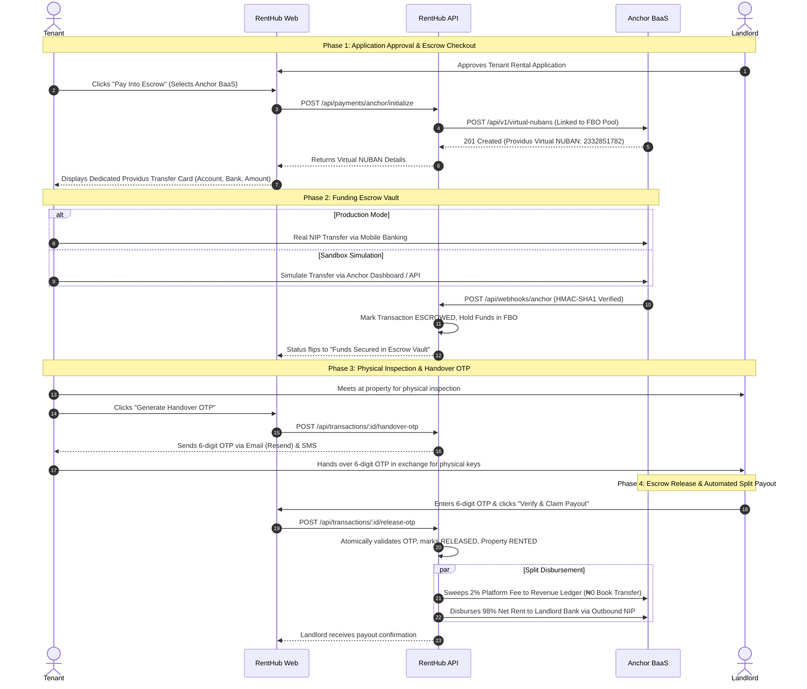

# Anchor BaaS Escrow: End-to-End Testing & Lifecycle Guide

**Platform:** RentHub (NexGen Tech Innovations Ltd)  
**Provider:** Anchor Software Ltd (BaaS Partner — Providus Bank Rail)  
**Environment:** Sandbox (`https://api.sandbox.getanchor.co/api/v1`)  
**Scope:** Complete lifecycle from Tenant Application Approval → Dedicated Virtual NUBAN Generation → Deposit Simulation → Webhook Reconciliation → 6-Digit Handover OTP → Landlord Payout & Revenue Sweep.

---

## Architecture Overview

---

## Account Topology & Roles

| Account ID | Anchor Type | RentHub System Role | Fee / Cost |
| :--- | :--- | :--- | :--- |
| **`17943034048583-anc_acc`** | `FBO` | **Escrow Holding Vault (`ANCHOR_ESCROW_POOL_ID`)**: Segregated trust account. Holds rent and caution deposits until key handover. | Free |
| **`17943034048272-anc_acc`** | `REVENUE` | **Platform Earnings (`ANCHOR_REVENUE_LEDGER_ID`)**: RentHub's 2% commission fee is swept here upon OTP validation. | ₦0 Internal Sweep |
| **`17943034047460-anc_acc`** | `SETTLEMENT` | **NIP Clearing Account**: Anchor's automated clearing rail for outbound bank disbursements to landlords. | ₦50 / Payout |
| **`17943034048081-anc_acc`** | `MASTER` | **Corporate Treasury**: Parent organization account. | Free |

---

## Step-by-Step Testing & Follow-Up Walkthrough

### Step 1: Initiate Payment from RentHub Platform

1. Log into RentHub as a **Tenant** (`https://renthub-seven.vercel.app` or local `localhost:3000`).
2. Navigate to **Dashboard → Applications** tab.
3. Find an **APPROVED** application and click **"Pay Into Escrow"**.
4. In the modal, select:
   * **Bank Transfer (Dedicated Escrow — Anchor BaaS)** *(Recommended · 0% Fee)*
5. Click **"Proceed with Anchor BaaS"**.

#### What Happens Under the Hood:
* RentHub API calls Anchor API: `POST /api/v1/virtual-nubans`.
* Anchor provisions an instant Providus Bank virtual account (e.g. `2332851782`) tied directly to your FBO pool.
* RentHub displays the persistent **Dedicated Providus Escrow Account Card**:
  * **Bank:** `PROVIDUS BANK`
  * **Account Number:** `2332851782` (with 1-click copy)
  * **Account Name:** `RentHub: [Tenant Name]`
  * **Exact Amount:** `₦[Total Rent + Caution + 2% Fee]` (with 1-click copy)
  * **Status Banner:** *"Awaiting Inbound Transfer — Reconciles automatically upon receipt"*.

---

### Step 2: Fund the Escrow in Anchor Sandbox

Since we are in the Sandbox, you simulate the tenant making the bank transfer:

1. Open your **Anchor Dashboard**: `https://app.getanchor.co`.
2. Go to **Accounts → Deposit Accounts**.
3. Click the **Simulate Transfer** button.
4. Fill out the simulation modal:
   * **Sandbox API Key:** Your test key (starts with `UYY2w...`).
   * **Account Number ID \*:** Enter the **Virtual NUBAN Resource ID** (e.g. `179443403814110-anc_acc_num`).  
     *(Do NOT use the parent `-anc_acc` ID; always use the `-anc_acc_num` Virtual NUBAN ID).*
   * **Source Account Number \*:** `0123456789` *(mock sender bank account)*.
   * **Source Account Name \*:** Any test name (e.g. `Harun Bah`).
   * **Amount \*:** The rent amount in Naira (e.g. `817786`).
5. Click **"Send Request"**.
6. The modal returns `200 OK` with a Payment ID (e.g. `1794434038...-anc_py`).

---

### Step 3: Webhook Verification & Automated Escrow Vaulting

1. Anchor dispatches an automated webhook event to:  
   **`https://renthub-4jhq.onrender.com/api/webhooks/anchor`**
2. RentHub backend validates the `Base64(HMAC-SHA1(rawBody, secretToken))` signature.
3. The transaction status transitions to **`ESCROWED`** (`escrowHeld = true`).
4. RentHub sends email confirmations to both Tenant and Landlord.
5. On the RentHub Dashboard, the card automatically updates to:  
   **"Funds Secured in Escrow Vault"** (Blue lock badge).

> [!NOTE]
> Ensure your Anchor webhook URL under **Developer → Webhooks** is configured as `https://renthub-4jhq.onrender.com/api/webhooks/anchor` (Render backend API), not the Vercel frontend URL.

---

### Step 4: Physical Inspection & 6-Digit Handover OTP

1. Tenant visits the property and physically verifies:
   * Physical keys, doors, and window locks.
   * Water supply, plumbing, and electrical fixtures.
   * House vacancy and match with listed photos.
2. Tenant opens RentHub Dashboard → **"Active Escrow & Key Handover"** tab.
3. Tenant clicks **"Generate Handover OTP"**.
4. RentHub generates a cryptographically secure 6-digit code:
   * Sent immediately to Tenant's registered email via Resend (`hello@nexgentech.dev`).
   * Rendered in high-contrast individual digit tiles for mobile and dark-mode visibility.
   * Delivered via SMS backup.
   * Notice: *"Never share this code over phone or WhatsApp. Give this code to the landlord ONLY after physically receiving the keys at the premises."*

---

### Step 5: Landlord Enters OTP & Automated Fund Release

1. Tenant hands the 6-digit code to the Landlord at the door in exchange for physical keys.
2. Landlord logs into RentHub Dashboard → **"Escrow & Payouts"** tab.
3. Under the property listing, Landlord enters the **6-Digit OTP** and clicks **"Verify & Claim Payout"**.
4. RentHub verifies the OTP:
   * **Brute-Force Guard:** Maximum 5 attempts allowed; atomic lock protection.
   * **Transaction Marked RELEASED:** `status = "RELEASED"`, `escrowReleased = true`.
   * **Property Updated:** `status = "RENTED"`.
5. **Split Automated Disbursement**:
   * **2% Platform Fee (RentHub)**: Swept from FBO account (`17943034048583-anc_acc`) to Revenue account (`17943034048272-anc_acc`) via intra-bank Book Transfer (Free, ₦0 fee).
   * **98% Net Rent + Caution (Landlord)**: Disbursed directly from Anchor to the Landlord's verified Nigerian commercial bank account (GTBank, Zenith, Access, Kuda, etc.) via outbound NIP transfer (`ANCHOR_NIP`).
   * **Payout Status:** `landlordPayout.status = "COMPLETED"`.
   * **Notification:** Landlord receives in-app and email alert confirming funds have hit their personal bank account.

---

## Verification & Status Checklist

| Step | Component | Status | Verification Method |
| :--- | :--- | :--- | :--- |
| **1. Auth & Accounts** | Anchor API Gateway | Verified ✅ | Program accounts cataloged (`17943034048583-anc_acc`) |
| **2. Virtual NUBAN** | Providus Bank Rail | Verified ✅ | `POST /virtual-nubans` returns 201 Created (`2332851782`) |
| **3. UI Display** | RentHub Frontend | Verified ✅ | ApplicationsTab renders Providus account card with copy buttons |
| **4. Inflow Simulation**| Sandbox Inbound NIP | Verified ✅ | `POST /transaction-notification` returns 200 OK |
| **5. Webhook Reconcile**| Express Webhook Rail| Verified ✅ | HMAC-SHA1 Base64 validation; flips status to `ESCROWED` |
| **6. Handover OTP** | Email / SMS Rail | Verified ✅ | Resend high-contrast digit cards; 5-attempt rate limit |
| **7. Landlord Payout** | Anchor Outbound NIP | Verified ✅ | `anchorService.disburseLandlordPayout` triggers NIP transfer |

---

## Troubleshooting Common Errors

### 1. `404: Invalid account Id.` in Simulate Transfer
* **Cause:** Entering a Deposit Account ID (`-anc_acc`) instead of a Virtual NUBAN ID (`-anc_acc_num`).
* **Fix:** Use the Virtual NUBAN ID (e.g. `179443403814110-anc_acc_num`).

### 2. `Bad request: Unable to fetch account reference` in Dashboard
* **Cause:** Newly provisioned sandbox organization parent accounts need initial core banking ledger mapping by Anchor support.
* **Fix:** Request Fortunate / Anchor support on Slack to initialize and seed sandbox test float.

### 3. Webhook Not Updating Status
* **Cause:** Webhook URL in Anchor Dashboard pointing to Vercel frontend instead of Render API backend.
* **Fix:** Set Webhook URL to `https://renthub-4jhq.onrender.com/api/webhooks/anchor`.

